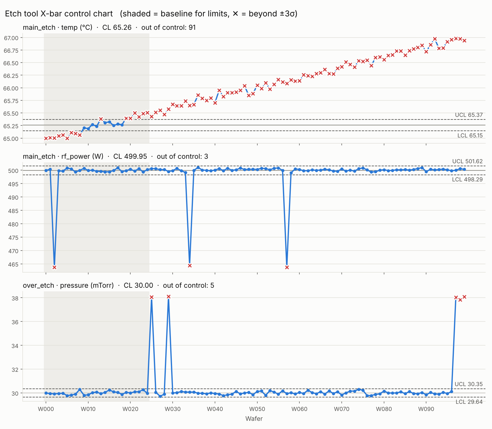
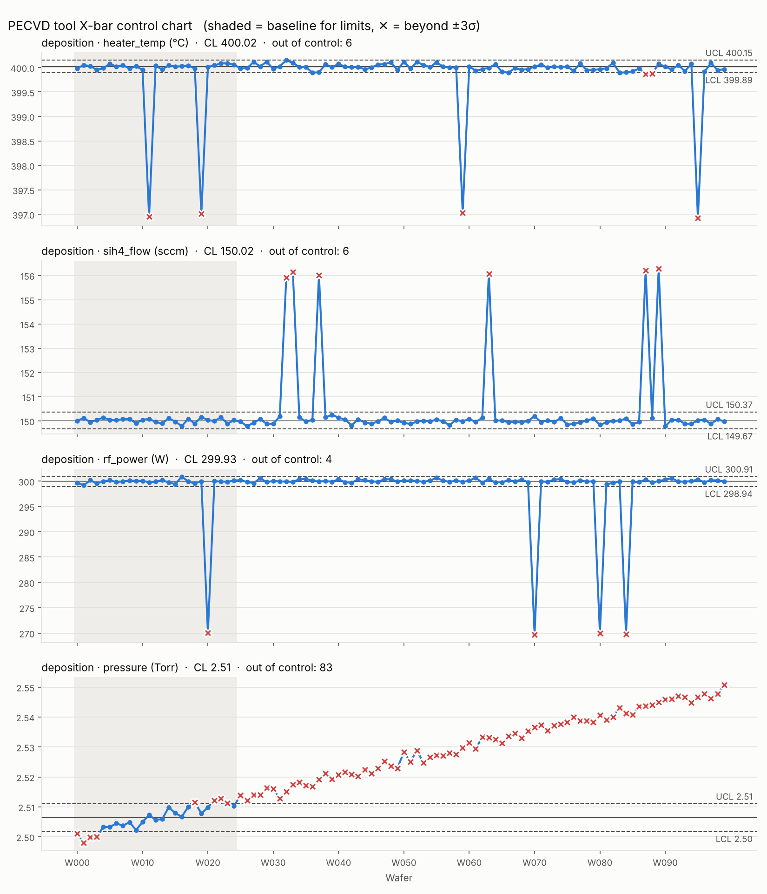

# [예제 015] 반도체 공정 가상 데이터와 관리도

반도체 설비의 FDC 센서 데이터를 가상으로 만들고, X-bar 관리도로 이상을 찾아내는 예제입니다.
설비 종류는 **설정 파일(`configs/*.yaml`)** 로 정의하므로, 새 설비를 추가할 때 파이썬 코드는 바꿀 필요가 없습니다.

## 실행

```bash
pip install -r requirements.txt

# 식각(Etch) 설비 (기본)
python generate_data.py
python control_chart.py

# PECVD 증착 설비
python generate_data.py --config configs/cvd.yaml
python control_chart.py --config configs/cvd.yaml
```

| 옵션 | 설명 |
|---|---|
| `--config` | 설비 설정 파일 (기본: `configs/etch.yaml`) |
| `--seed` | 난수 시드. 생략하면 매번 랜덤이고, 사용한 시드가 화면에 출력됩니다 |
| `--wafers` | 웨이퍼 수 (생략하면 설정 파일 값) |
| `--out` | 저장 폴더 (기본: `data/<equipment>`, `output/<equipment>`) |
| `--base` | 관리도 기준 웨이퍼 수 (`control_chart.py`, 생략하면 설정 파일 값) |

## 파일 구조

```
config.py            설정 파일 읽기·검사 (공용)
generate_data.py     가상 데이터 생성
control_chart.py     관리도 생성
configs/
  etch.yaml          식각 설비
  cvd.yaml           PECVD 산화막 증착 설비
data/<equipment>/    trace.csv, summary.csv  (실행 시 생성, git 제외)
output/<equipment>/  control_chart.png, violations.csv
```

## 설정 파일 작성법

```yaml
equipment: etch          # 출력 폴더 이름
title: Etch tool         # 관리도 제목
wafers: 100

sensors:                 # 단위, 잡음(표준편차), 웨이퍼당 드리프트(설비 열화)
  temp:     {unit: "°C",    noise: 0.3, drift: 0.02}
  rf_power: {unit: "W",     noise: 3}

steps:                   # 스텝별 시간(초)과 센서 설정값. 0 = 꺼짐
  - {name: main_etch, duration: 40, temp: 65, rf_power: 500}

faults:                  # 웨이퍼마다 최대 1개가 prob 확률로 발생
  - {name: rf_drop, prob: 0.05, step: main_etch, sensor: rf_power, type: scale, value: 0.85, start: 21}

chart:
  baseline: 25           # 관리 한계를 계산할 앞쪽 웨이퍼 수
  metrics:               # 관리도에 그릴 항목 (스텝별 평균)
    - {sensor: temp, step: main_etch}
```

고장 유형(`type`):
- `scale`: 값에 `value`를 곱합니다 (예: RF 15% 저하 → `0.85`)
- `offset`: 값에 `value`를 더합니다 (예: 압력 스파이크 → `8`)
- `ramp`: 스텝 동안 0에서 `value`까지 점점 더합니다 (예: MFC 유량 드리프트)
- `start`: 스텝 시작 후 몇 초부터 적용할지 (생략하면 0)

설정 파일에 오타가 있으면(없는 센서·스텝 이름, 확률 합 > 1 등) 실행 전에 오류 메시지로 알려줍니다.

## 관리도 (`control_chart.py`)

- 앞쪽 `baseline`장(회색 구간)으로 관리 한계(CL ± 3σ)를 계산합니다.
- 웨이퍼당 값이 하나이므로 σ는 이동범위로 추정합니다 (σ = 평균 이동범위 / 1.128).
  기준 구간 안의 이탈점은 빼고 다시 계산합니다.
- 한계를 벗어난 웨이퍼는 빨간 ✕로 표시하고 `violations.csv`에 저장합니다.

### Etch (`--seed 42`)



- **온도**: 설비 열화로 계속 오르기 때문에 기준 구간 안에서부터 한계를 벗어납니다 → 공정이 안정 상태가 아니라는 신호 (PM 필요)
- **RF 파워**: `rf_drop` 고장 3장 모두 검출
- **압력**: `pressure_spike` 고장 5장 모두 검출

### PECVD (`--seed 42`)



- **히터 온도**: `heater_drop` 4장 검출 (정상 웨이퍼 1장이 LCL에 살짝 걸림)
- **SiH4 유량**: `sih4_mfc_drift` 6장 모두 검출
- **RF 파워**: `rf_mismatch` 4장 모두 검출
- **압력**: 챔버 벽 증착물 누적으로 서서히 상승 → 챔버 세정 시점 신호
