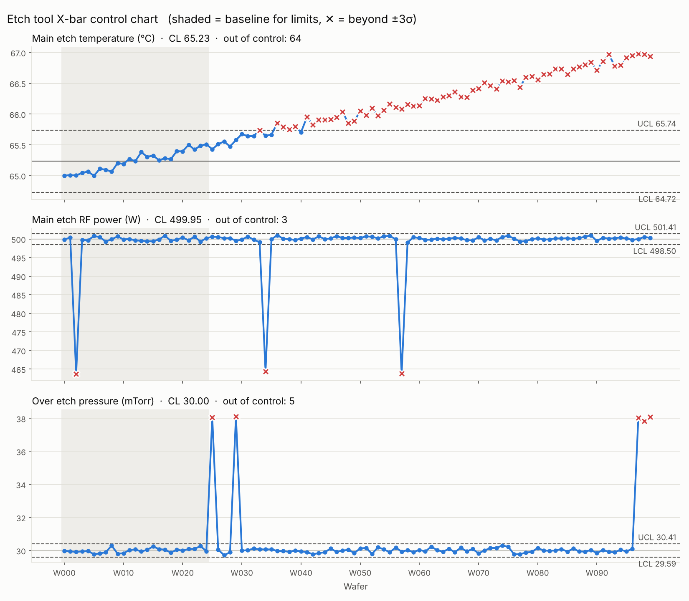

# [예제 015] 반도체 공정 가상 데이터와 관리도

식각(Etch) 설비의 FDC 센서 데이터를 가상으로 만들고, X-bar 관리도로 이상을 찾아내는 예제입니다.

## 실행

```bash
pip install -r requirements.txt
python generate_data.py      # data/trace.csv, data/summary.csv 생성
python control_chart.py      # output/control_chart.png, output/violations.csv 생성
```

`generate_data.py`는 실행할 때마다 새로운 랜덤 데이터를 만들고, 사용한 시드를 화면에 출력합니다.
같은 데이터를 다시 만들려면 그 시드를 `--seed`로 넘기면 됩니다.

옵션 예시: `python generate_data.py --wafers 200 --drift 0.01 --seed 42`,
`python control_chart.py --base 30`

## 가상 데이터 구성 (`generate_data.py`)

| 레시피 스텝 | 시간(초) | 온도(℃) | 압력(mTorr) | RF(W) | 가스(sccm) |
|---|---|---|---|---|---|
| stabilize | 10 | 60 | 50 | 0 | 100 |
| main_etch | 40 | 65 | 30 | 500 | 80 |
| over_etch | 15 | 65 | 30 | 300 | 60 |
| purge | 5 | 60 | 80 | 0 | 200 |

- **노이즈**: 각 센서에 정규분포 잡음
- **설비 열화**: 웨이퍼가 진행될수록 온도가 조금씩 상승 (`--drift`, 기본 0.02℃/장)
- **고장 주입** (각 5%): `rf_drop`(main_etch 후반 RF 15% 저하), `pressure_spike`(over_etch 압력 +8mTorr)

## 관리도 (`control_chart.py`)

- 앞쪽 25장(회색 구간)으로 관리 한계(CL ± 3σ)를 계산합니다. 기준 구간 안의 이탈점은 빼고 다시 계산합니다.
- 한계를 벗어난 웨이퍼는 빨간 ✕로 표시하고 `output/violations.csv`에 저장합니다.



결과 해석 (`--seed 42`, 위 그림 기준):
- **온도**: 열화로 인한 드리프트 때문에 W033 이후 대부분이 UCL을 넘습니다 → PM(예방정비) 시점 신호
- **RF 파워**: `rf_drop` 고장 웨이퍼 3장이 정확히 검출됩니다
- **압력**: `pressure_spike` 고장 웨이퍼 5장이 정확히 검출됩니다
